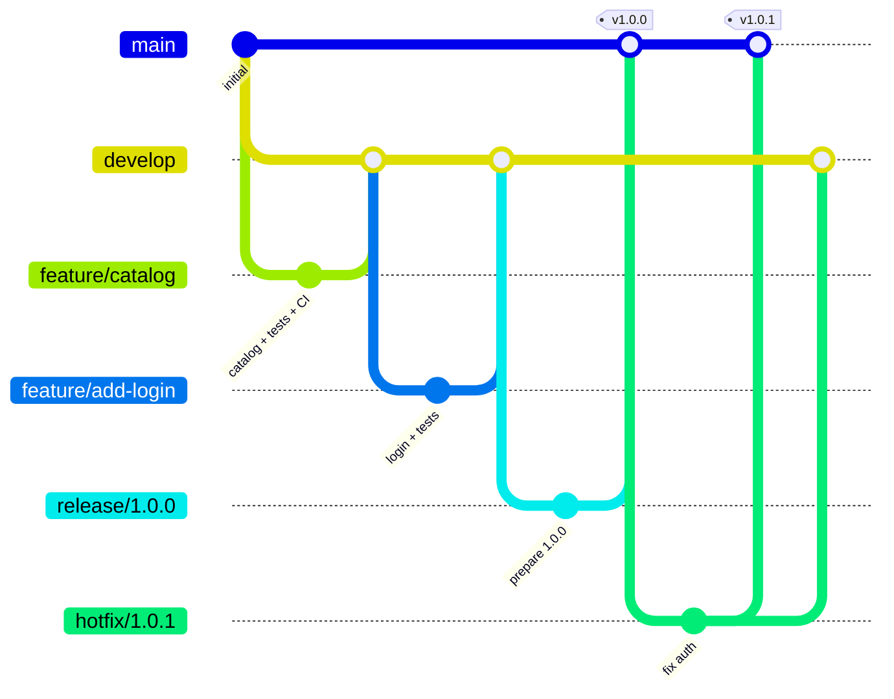

# ModaLine — release engineering on a small Flask API

[](https://github.com/whiteinfra/modaline/actions/workflows/ci.yml)
[](https://github.com/whiteinfra/modaline/actions/workflows/release.yml)
[](https://github.com/whiteinfra/modaline/releases)

A minimal REST API for an online clothing store, used to practise **how software gets delivered**: GitFlow branching, Semantic Versioning, Conventional Commits, automated tests and tag-driven releases with GitHub Actions.

Originally built as Lab #1 for the *Software Product Development Technologies* course. The Ukrainian version of this README is in [README.uk.md](README.uk.md).

## What's inside

| Area | Implementation |
|---|---|
| App | Flask app factory, `catalog` and `auth` blueprints |
| Tests | pytest: catalog listing, filters, 404, login success/failure |
| CI | [`ci.yml`](.github/workflows/ci.yml): pytest on every push to `main`, `develop`, `feature/**`, `release/**`, `hotfix/**` and on pull requests |
| CD | [`release.yml`](.github/workflows/release.yml): on a `v*.*.*` tag, runs tests, checks the tag matches [`VERSION`](VERSION), builds a zip artifact with `git archive` and publishes a GitHub Release with notes from [`releases/`](releases) |
| Versioning | [SemVer + GitFlow policy](VERSIONING.md), [CHANGELOG](CHANGELOG.md) in Keep a Changelog format |
| Process | Scrum lifecycle rationale ([LIFECYCLE.md](LIFECYCLE.md)), [release notes template](RELEASE_TEMPLATE.md), [acceptance checklist](ACCEPTANCE_CHECKLIST.md) |

## Branching model



Inspect the real history:

```bash
git log --graph --oneline --decorate --all
git tag -n
git describe --tags
```

## Run locally

```bash
python -m venv .venv && source .venv/bin/activate   # Windows: .venv\Scripts\activate
pip install -r requirements.txt
pytest -q
flask --app app:create_app run                      # http://127.0.0.1:5000/api/products
```

## API

| Method | Endpoint | Description |
|---|---|---|
| GET | `/api/version` | Current app version (read from `VERSION`) |
| GET | `/api/products?category=&size=` | Product catalog with filters |
| GET | `/api/products/<id>` | Single product, 404 if missing |
| POST | `/api/auth/login` | Login, returns a token (demo user `student@modaline.ua` / `Passw0rd!`) |

> Demo credentials and the secret key are for local testing only.

## Release flow

1. Finish a `release/x.y.z` or `hotfix/x.y.z` branch, bump [`VERSION`](VERSION) and update the [CHANGELOG](CHANGELOG.md)
2. Merge into `main` and tag: `git tag -a vX.Y.Z -m "Release X.Y.Z"`
3. Push the tag: `git push origin vX.Y.Z`
4. GitHub Actions tests the tag, builds `modaline-vX.Y.Z.zip` and publishes the release

## Author

Vladyslav Bilous · [github.com/whiteinfra](https://github.com/whiteinfra)
