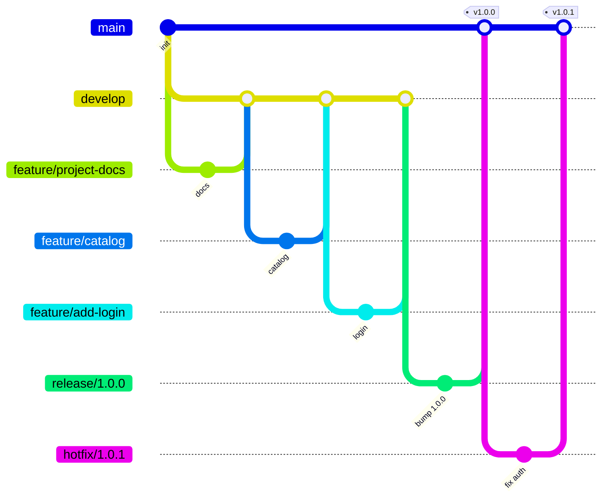

# Політика версіонування та робота з Git

## 1. Семантичне версіонування (SemVer 2.0.0)

Формат версії: **MAJOR.MINOR.PATCH** (наприклад, `1.4.2`).

| Частина | Коли збільшується | Приклад для ModaLine |
|---|---|---|
| MAJOR | Зламні (несумісні) зміни публічного API або формату даних | Змінено структуру відповіді `GET /api/products` → `2.0.0` |
| MINOR | Нова функціональність, сумісна з попередньою | Додано кошик або фільтр за кольором → `1.1.0` |
| PATCH | Виправлення помилок без зміни API | Виправлено вхід з email у верхньому регістрі → `1.0.1` |

Додаткові правила:

- При збільшенні MAJOR скидаються MINOR і PATCH (`1.7.3 → 2.0.0`), при збільшенні MINOR скидається PATCH (`1.0.1 → 1.1.0`).
- Версії `0.y.z` — початкова розробка, API нестабільний.
- Передрелізні версії: `1.1.0-rc.1`, `1.1.0-beta.2`; метадані збірки: `1.1.0+20261011`.
- Джерело істини — файл `VERSION` у корені репозиторію; застосунок читає версію з нього (`GET /api/version`).
- Кожен реліз позначається анотованим тегом `vX.Y.Z` і описується в `CHANGELOG.md` та release notes.

Приклад еволюції: `1.0.0` (MVP) → `1.1.0` (нова функціональність) → `1.1.1` (багфікс) → `2.0.0` (зламна зміна).

## 2. Git-стратегія: GitFlow

| Гілка | Призначення | Створюється від | Зливається в |
|---|---|---|---|
| `main` | Лише стабільні релізні версії, кожен коміт злиття має тег | — | — |
| `develop` | Інтеграція готових фіч, база для наступного релізу | `main` | `release/*` |
| `feature/<назва>` | Розробка однієї фічі/історії | `develop` | `develop` (`--no-ff`) |
| `release/<версія>` | Підготовка релізу: версія, CHANGELOG, дрібні виправлення | `develop` | `main` + `develop` |
| `hotfix/<версія>` | Термінове виправлення у production | `main` | `main` + `develop` |



## 3. Повідомлення комітів (Conventional Commits)

Формат: `<тип>(<область>): <опис>`. Типи: `feat` (нова функція → MINOR), `fix` (виправлення → PATCH), `docs`, `test`, `refactor`, `chore`, `ci`. Зламна зміна позначається `!` (`feat(api)!: ...`) або рядком `BREAKING CHANGE:` у тілі коміту → MAJOR.

## 4. Робота з фічею

```bash
git checkout -b feature/add-login develop
git add .
git commit -m "feat(auth): add login endpoint"
git push origin feature/add-login
# після код-рев'ю:
git checkout develop
git merge --no-ff feature/add-login
git push origin develop
git branch -d feature/add-login
```

## 5. Випуск релізу

```bash
git checkout -b release/1.0.0 develop
echo 1.0.0 > VERSION                      # оновити версію
# оновити CHANGELOG.md: [Unreleased] -> [1.0.0] - YYYY-MM-DD
git commit -am "chore(release): 1.0.0"
git checkout main
git merge --no-ff release/1.0.0
git tag -a v1.0.0 -m "Release 1.0.0"
git push origin main v1.0.0
git checkout develop
git merge --no-ff release/1.0.0
git branch -d release/1.0.0
```

## 6. Hotfix

```bash
git checkout -b hotfix/1.0.1 main
# виправлення + тест
git commit -am "fix(auth): case-insensitive email, 400 on empty password"
echo 1.0.1 > VERSION && git commit -am "chore(release): 1.0.1"
git checkout main && git merge --no-ff hotfix/1.0.1
git tag -a v1.0.1 -m "Hotfix 1.0.1"
git checkout develop && git merge --no-ff hotfix/1.0.1
git branch -d hotfix/1.0.1
```

## 7. Правила захисту гілок

- У `main` і `develop` зміни потрапляють лише через Pull Request; потрібні зелений CI та щонайменше 1 approve.
- `force-push` у `main`/`develop` заборонено; теги релізів не переписуються.
- Історія релізів ведеться в `CHANGELOG.md` і тегах Git — це єдине джерело правди про версії.
